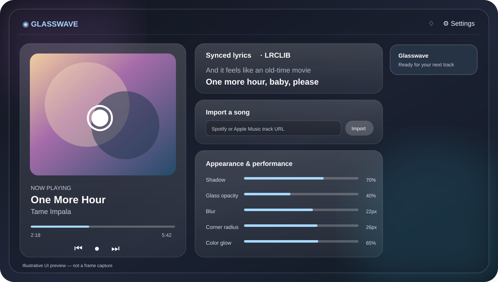

<div align="center">
  
  <h1>Glasswave</h1>
  <p><strong>A focused desktop music companion for links, lyrics, and late-night listening.</strong></p>
  <p>Self-contained HTML · Electron desktop · MIT licensed</p>
</div>

Glasswave is a lightweight music-player interface built around official playback services. Import a Spotify or Apple Music link to open it in that service, or use YouTube's official embedded player for a selected video. Glasswave does not download, rip, or circumvent protected audio.

## Highlights

- **Music links:** Import Spotify and Apple Music song or playlist URLs. Playback is handed to the official app or web player, with the service's own account and subscription rules.
- **YouTube playback:** Use the official YouTube embed for a chosen video match. Search opens YouTube; select a result yourself and paste its URL or ID.
- **Synced lyrics:** Fetch line-timed lyrics from LRCLIB. Karaoke mode highlights the active line and follows it as the song progresses.
- **Make it yours:** Ocean, Ember, Violet, Forest, and Monochrome palettes; custom glow and background; glass, blur, shadow, corner, glow, and motion controls.
- **Low-end mode:** Reduce visual effects for less capable PCs. Preferences persist locally in the browser profile.

> **Playback note:** Spotify and Apple Music links are service handoffs, not native desktop-session control. Volume and transport controls inside Glasswave do not control a Spotify desktop session in this repository version. A Spotify app must be used directly for those actions.

## Preview


The preview is an original project illustration, not a screenshot or borrowed artwork.

## Run Glasswave

### In a browser

Open `index.html` in a modern browser. Internet access is needed for lyrics, metadata, and embedded playback.

### As an Electron app

Install Node.js 20 or newer, then from the project directory:

```sh
npm install
npm start
```

## Build Windows apps

On Windows, run:

```sh
npm install
npm run dist
```

The `dist` folder contains x64 NSIS installer and portable `.exe` builds. The package uses Electron `^35.0.0`, app ID `com.glasswave.player`, and electron-builder. GitHub Actions builds and attaches both executables when a `v*` tag is pushed.

## Project notes

Glasswave keeps its UI in one self-contained `index.html`; Electron's `main.js` provides the desktop shell. The project does not bundle music or service credentials. Link metadata comes from Spotify oEmbed and Apple's public iTunes Search API; lyrics are from LRCLIB.

## Credits

- [Electron](https://www.electronjs.org/) and [electron-builder](https://www.electron.build/)
- [LRCLIB](https://lrclib.net/) for lyric metadata
- [YouTube IFrame Player API](https://developers.google.com/youtube/iframe_api) for official embedded playback
- Spotify oEmbed and Apple's public iTunes Search API for link metadata

Glasswave is independent and is not affiliated with Spotify, Apple, YouTube, or LRCLIB.

## License

Released under the [MIT License](./LICENSE).
